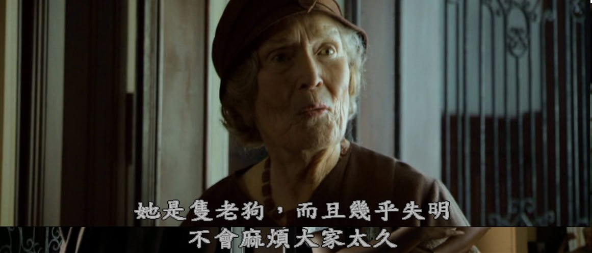

# 班傑明的奇幻旅程
報告人：4114053104 陳奕其

---

## 小說
班傑明的奇幻旅程
作者：法蘭西斯·史考特·費茲傑羅

---

### 社會期待對人的壓迫
- 不符合年齡期待的人
- 父權框架中的弱勢
- 資產階級不明說價值觀與互動方法
<!-- 沒有難解狀態，只有方向 -->
---

### 不符合年齡期待的人
- 老班傑明在小時候要染頭髮，被要求像個孩子
- 大學覺得老班傑明太老不讓他入學
- 對於老少配的接受度

---

### 父權框架中的弱勢

- 老班傑明和祖父比較要好，和父親關係不好
- 父親有養育（逗弄）兒子的想像
- 希爾嘉覺得年長、事業有成的男人才能照顧好他
- 班傑明在妻子年老後和妻子的互動平淡而參加戰爭
- 對於女人的排他活動

---

### 資產階級不明說價值觀與互動方法
- 聚會活動中父親的重要性
- 世家企業間的個人形象和互動方式
- 回收鐵釘的手段

---

# 電影
班傑明的奇幻旅程
大衛·芬奇執導

---

## 生命的各個階段
- 人如何在脆弱的狀態照顧、被照顧
- 不同年齡階段愛情的相處之道
- 死亡前人們的心態

---

## 人如何在脆弱的狀態照顧、被照顧
- 幼兒、老年人被照顧的方式
- 黛西坦然接受伊莉莎白給班傑明溫暖
  - 原本女兒想跳過不講這段
- 戰死前的船員一心想寄錢回家照顧家人

---

### 不同年齡階段愛情的相處之道
- 愛情進行的方式
  - 嫖妓
  - 彈鋼琴老婆婆
  - 和官員的老婆在晚上
  - 黛絲的十年養成計畫
  - 黛絲後來和鰥夫再組家庭

---

### 不同年齡層愛情的相處之道
- 班傑明對黛絲的包容與退讓

---

### 不同年齡層中愛情的相處之道
- 黛絲對班傑明的包容與退讓

---

### 人們對生命死亡前的心態

---

### 人們對生命死亡前的心態
- 養老院那些快死的人通常只生活中的瑣事，他們例外
  - 只唱華格納歌劇的席寶華格納夫人
  - 彈鋼琴的太太
  - 相當年——被閃電劈七次的人

---

### 人們對生命死亡前的心態
- 養老院那些快死的人
- 老狗快死了，不會為難大家

---

---

### 人們對生命死亡前的心態
- 養老院那些快死的人
- 老狗快死了，不會為難大家
- 班傑明在失憶前寫下一生的紀錄
- 黛絲死前想聽班傑明的故事

---

## 電影改編的技巧

---

### 班傑明出生的時代背景
- 南北戰爭剛結束（1865）
- 一次世界大戰剛結束（1918）

---

### 班傑明出生的時代背景
- 南北戰爭剛結束（1865）
- 一次世界大戰剛結束（1918）

1918-1865=53

---

### 敘事視角
- 上帝視角看巴頓一家
- 黛絲讀班傑明的日記 + 後半老黛絲旁白回憶班傑明的一生
  - 1985/4/4 年班傑明失憶前寫日記回顧

---

### 巴頓家的職業
- 釘子
  - 實用、功利主義
- 鈕扣
  - 平滑、隨和
---

## Bouba kiki effect

---

### 戰爭的參與形式

- 年輕旅居對班傑明心智重大的影響

---

### 電影經歷了不同形式的家庭
- 收養家庭
  - 養父母的親生小孩出生
- 遠距離家庭
  - 獨立自主、寫信
- 小家庭
- 重組家庭

---

## 與時間有關的特殊意象
- 倒轉時鐘
  - 1918 興建
  - 2002 拆除倒轉時鐘
- 卡崔娜颶風侵襲
  - 黛絲在 2005 住院遭遇颶風

---

## 與時間有關的特殊意象
- 倒轉時鐘
  - 1918 興建
  - 2002 拆除倒轉時鐘
- 卡崔娜颶風侵襲
  - 黛絲在 2005 住院遭遇颶風

他們都是逆時針轉的！

