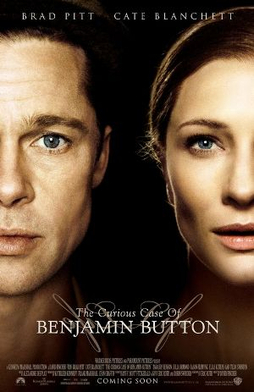
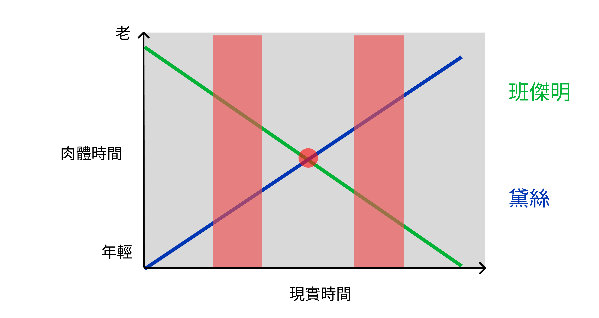

# 班傑明的奇幻旅程
報告人：4114053104 陳奕其

---

## 小說

---

### 社會期待對人的壓迫
- 不符合年齡期待的人
- 父權框架中的弱勢
- 資產階級不明說價值觀與互動方法
<!-- 沒有難解狀態，只有方向 -->
---

### 社會對於各年齡的期待
- 老班傑明在小時候要染頭髮，被要求像個孩子
- 大學覺得老班傑明太老不讓他入學
- 對於老少配的接受度

---

### 在在父權框架中的弱勢

- 老班傑明和祖父比較要好，和父親關係不好
- 父親有養育（逗弄）兒子的想像
- 希爾嘉覺得年長、事業有成的男人才能照顧好他
- 班傑明在妻子年老後和妻子的互動平淡而參加戰爭
- 對於女人的排他活動

---

### 資產階級的價值觀與身分規範
- 聚會活動中父親的重要性
- 世家企業間的個人形象和互動方式
- 

---

# 電影

---

## 生命的階段
- 家的不同形式
- 不同年齡層愛情的相處之道
- 肉體和個人經驗的落差
---

### 家的不同形式
- 收養家庭
- 遠距離家庭
- 小家庭
- 重組家庭

---

### 重要的差異
- 年輕旅居對班傑明心智重大的影響

---

### 不同年齡層中愛情的相處之道
- 相近年齡發展愛情的方式
  - 彈鋼琴老婆婆
  - 和官員的老婆外遇
  - 黛絲的十年養成計畫

---

### 不同年齡層愛情的相處之道
- 班傑明對黛絲的包容與退讓

---

### 不同年齡層中愛情的相處之道
- 黛絲對班傑明的包容與退讓

---

### 肉體和個人經驗的落差
- 船長覺得老班傑明是處男的訝異
- 班傑明各個階段的工作
  - 水手、軍人、清潔工...
- 敘事視角從老黛絲出發

<!-- 電影改編的技巧
例如旁白
讓黛絲臥床，敘事效果
 -->